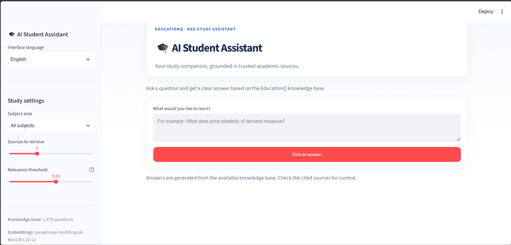
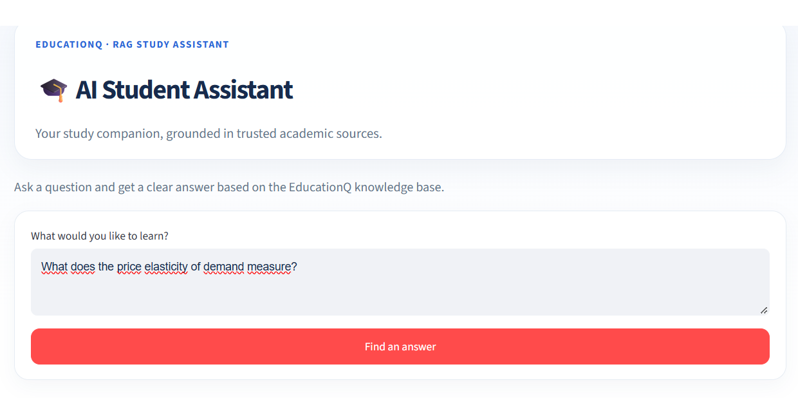
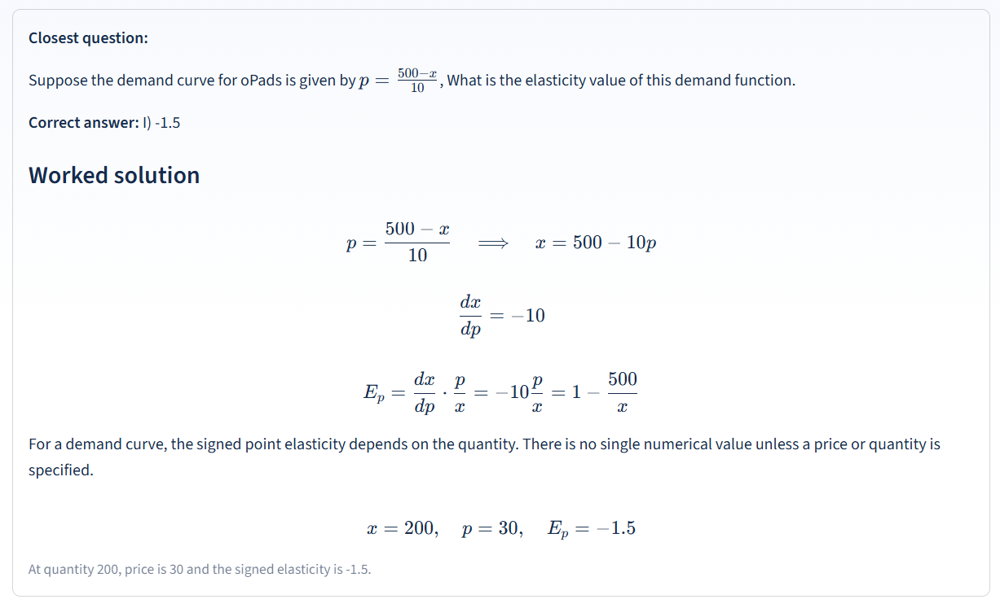
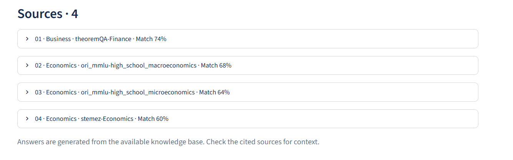
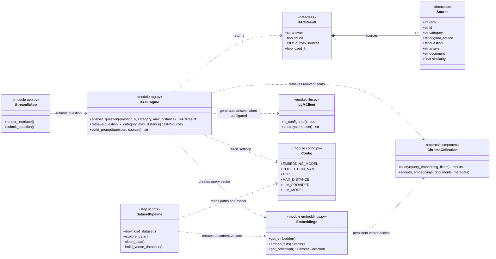

# 🎓 AI Student Assistant — Academic Question Answering with RAG

**Team:** Dhifallah Mohamed Amine · Dhia Ben Laghmari

## Links

- GitHub repository: [AI Student Assistant](https://github.com/YOUR_GITHUB_USERNAME/AI_Student_Assistant)
- LinkedIn: [Developer profile](https://www.linkedin.com/in/YOUR_LINKEDIN_PROFILE/)

Replace the URL placeholders above with the team's actual profile and repository links before publishing.

An intelligent assistant that answers students' academic questions in natural
language. It searches a knowledge base built from the **EducationQ** dataset,
then uses a **Large Language Model** to write a clear answer and shows the
**sources** it used (Retrieval-Augmented Generation).

```
Student ─► Question ─► Streamlit ─► Embedding ─► ChromaDB ─► Relevant items ─► LLM ─► Answer + sources
```

## Application screenshots

| Home screen | Question form |
|---|---|
|  |  |

| Answer with worked solution | Retrieved sources |
|---|---|
|  |  |

## Class diagram

The main Python data classes are `RAGResult` and `Source`. The remaining boxes represent the modules and external components they work with.



| Spec requirement | Where it is |
|---|---|
| Python, Pandas | everywhere / `step2`, `step3` |
| Dataset download, inspection, cleaning | `step1_download_data.py`, `step2_explore_data.py`, `step3_clean_data.py` |
| Embeddings (Sentence Transformer) | `embeddings.py`, `step4_build_vector_db.py` |
| Vector database (ChromaDB) | `step4_build_vector_db.py` → `chroma_db/` |
| RAG + LLM + "not found" message | `rag.py`, `llm.py` |
| Streamlit interface | `app.py` |
| Testing (section 9) | `step7_evaluate.py` |

---

## Project structure

```
ai-student-assistant/
├── config.py                  # all paths & settings in one place
├── data_utils.py              # loads the raw JSON file
├── step1_download_data.py     # 1. download EducationQ from Hugging Face
├── step2_explore_data.py      # 2. inspect: columns, missing values, duplicates, subjects
├── step3_clean_data.py        # 3. clean + build one "document" per question
├── embeddings.py              # Sentence Transformer + ChromaDB helpers
├── step4_build_vector_db.py   # 4. embed documents and store them in ChromaDB
├── llm.py                     # LLM client (Groq / OpenAI / Ollama)
├── rag.py                     # 5. retrieve → build prompt → generate answer
├── app.py                     # 6. Streamlit web app
├── step7_evaluate.py          # 7. tests from section 9 of the spec
├── requirements.txt
├── .env.example               # copy to .env and add your LLM key
├── data/raw/                  # (created) original dataset
├── data/processed/            # (created) cleaned dataset  ← deliverable
├── chroma_db/                 # (created) vector database  ← deliverable
└── results/                   # (created) evaluation results for the report
```

---

## Step 0 — Set up the environment

Requires **Python 3.10+**.

```powershell
py -m venv .venv
.\.venv\Scripts\python.exe -m pip install -r requirements.txt
```

The first install downloads PyTorch (~1 GB for sentence-transformers); that's normal.

## Step 1 — Download the dataset

```powershell
.\.venv\Scripts\python.exe .\step1_download_data.py
```
Saves `data/raw/educationq_full.json` (≈1.6 MB, 1,498 questions).
If the download fails, download `educationq_full.json` manually from the
[dataset page](https://huggingface.co/datasets/SunriserFuture/EducationQ/tree/main)
and put it in `data/raw/`.

**About the dataset.** EducationQ contains multiple-choice university-level questions:

* **1,300 MMLU-Pro** questions: 100 each across 13 subjects (business, law, psychology,
  biology, chemistry, history, health, economics, math, physics, engineering,
  philosophy, computer science) with a difficulty level (`+++++` hardest … `-----` easiest).
* **198 GPQA Diamond** questions: graduate-level science with an expert **explanation**.

Columns: `id, source, question, options, answer, answer_index, category,
difficulty, original_source, subdomain, explanation`.

## Step 2 — Explore the data

```powershell
.\.venv\Scripts\python.exe .\step2_explore_data.py
```
Prints the row count, missing values per column, duplicates, subject
distribution, question lengths, and an example row. **Copy these numbers into
your report** (they justify the cleaning choices).

## Step 3 — Clean and organize the data

```powershell
.\.venv\Scripts\python.exe .\step3_clean_data.py
```

| Spec item | What the script does |
|---|---|
| Clean unnecessary text | Unicode normalization, remove HTML tags, zero-width characters, repeated spaces/blank lines; drop empty/`N/A` options |
| Handle missing values | Drop rows without a question or a resolvable correct answer; GPQA rows have no `category` → derived from `subdomain` (`"Physics (general)"` → `physics`); empty `difficulty` → `unknown`; empty `explanation` kept as `""` |
| Remove duplicates | Same `id`, or same question text after lower-casing and removing punctuation |
| Organize the information | Converts the answer letter into the **answer text** and builds one readable **document** per question (subject, question, correct answer, explanation, incorrect options) |

Output: `data/processed/educationq_clean.csv` (open it in Excel) and `.jsonl`.

**Why turn MCQs into documents?** A RAG system retrieves *knowledge*, not
letters. "Correct answer: D" means nothing to a student, but
"Correct answer: Customer participation and environmental relationship" does.

## Step 4 — Generate embeddings and build ChromaDB

```powershell
.\.venv\Scripts\python.exe .\step4_build_vector_db.py
```
Run this step after switching from the old English-only model. It creates a
separate `educationq_multilingual` collection and leaves the original
`educationq` collection untouched. The model is downloaded the first time, so
the initial build needs an internet connection; later runs can use the cache.
* Model: `paraphrase-multilingual-MiniLM-L12-v2` (Sentence Transformer,
  384-dimensional vectors, supports English, French, and Arabic; downloaded
  automatically the first time).
* What is embedded: subject + question + correct answer + explanation
  (wrong options are left out so they don't pull the vector off-topic).
* Stored in a **persistent** ChromaDB collection (`chroma_db/`) with **cosine**
  distance, plus metadata (subject, original source, difficulty, answer) used
  for filtering and for showing sources.

Takes ~1 minute on a laptop CPU.

## Step 5 — Connect an LLM and test the RAG engine

```powershell
if (-not (Test-Path .env)) { Copy-Item .env.example .env }
notepad .env
```
Edit `.env` and choose **one** provider:

| Provider | Cost | How |
|---|---|---|
| **Groq** (recommended) | Free tier | Create a key at console.groq.com → `LLM_PROVIDER=groq`, `LLM_API_KEY=...` |
| Ollama | Free, offline | Install ollama.com, run `ollama pull llama3.2` → `LLM_PROVIDER=ollama` |
| OpenAI | Paid | `LLM_PROVIDER=openai`, `LLM_API_KEY=sk-...` |

If a model name stops working (providers retire models), set `LLM_MODEL` to one
listed in your provider's console.

The default Groq model is `openai/gpt-oss-20b`.

Test from the terminal:
```powershell
.\.venv\Scripts\python.exe .\rag.py "What does the price elasticity of demand measure?"
```

**How `rag.py` works:**
1. **Retrieve.** Embed the question, query ChromaDB for the top-k (default 4)
   most similar items (optionally only one subject).
2. **Filter.** Discard items whose cosine distance is above `MAX_DISTANCE`
   (0.65). If nothing is left, return the **"couldn't find"** message
   *without* calling the LLM (no hallucination, no cost).
3. **Augment.** Build a prompt containing the numbered items `[1] [2] ...`.
4. **Generate.** The LLM answers using only that context and cites `[n]`.
   If the context isn't enough it replies `NOT_FOUND`, which is turned
   into the same friendly message.

Without an API key the app still works in **retrieval-only mode** (shows the
closest question and its answer), which is useful for testing.

## Step 6 — Run the web app

```powershell
.\.venv\Scripts\python.exe -m streamlit run .\app.py
```
Opens http://localhost:8501 with: the project title, a question box, an
**Ask** button, the generated answer, and expandable **sources** (subject,
original source, similarity score, question, correct answer). The sidebar has
a subject filter, number of sources, and the relevance threshold.

## Step 7 — Test and evaluate

```powershell
.\.venv\Scripts\python.exe .\step7_evaluate.py            # retrieval tests (fast)
.\.venv\Scripts\python.exe .\step7_evaluate.py --answers  # + a few full generated answers for the report
```
Covers every point of section 9 of the specification:

| Spec test | Group | Success measure |
|---|---|---|
| Questions directly from the dataset | A | the same item is ranked #1 |
| Same questions, different wording | B | still ranked #1 / in top-k (paraphrased by the LLM if configured) |
| Questions not in the dataset | C | rejected by the threshold → "not found" |
| Different subjects | D | accuracy per subject |

Results are saved to `results/evaluation.csv` (and `results/sample_answers.md`).
Use them for tables/charts in the report. Also test by hand in the app with
your own questions and take screenshots.

**Tuning:** if good questions are rejected, raise `MAX_DISTANCE` in `.env`; if
off-topic questions get through, lower it.

---

## Deliverables checklist

- [x] Python source code — this folder
- [x] Cleaned dataset — `data/processed/educationq_clean.csv`
- [x] ChromaDB vector database — `chroma_db/`
- [x] Functional Streamlit application — `app.py`
- [ ] Technical report — use the explore/clean/evaluate outputs + screenshots
- [ ] Project presentation

## Limitations (good to mention in the report)

* The knowledge base is ~1,500 exam questions, not full course material, so
  coverage of any one topic is narrow; questions outside it correctly return "not found".
* Some MMLU-Pro answers are calculations without explanations; the LLM explains
  them from its own reasoning, guided by the retrieved correct answer.
* The EducationQ source material is in English. The multilingual embedding
  model supports questions in English, French, and Arabic, and the LLM is asked
  to answer in the language of the question. French and Arabic retrieval quality
  should be measured with representative questions before presenting results.
* **Possible improvements:** add course PDFs/notes in each language, chat
  history, and re-ranking.

## Dataset source & citation

EducationQ — https://huggingface.co/datasets/SunriserFuture/EducationQ (CC-BY-4.0)

> Yao Shi, Rongkeng Liang, Yong Xu. *EducationQ: Evaluating LLMs' Teaching
> Capabilities Through Multi-Agent Dialogue Framework.* ACL 2025 (Long Papers),
> pp. 32799–32828. DOI: 10.18653/v1/2025.acl-long.1576

Built on MMLU-Pro (Wang et al., 2024) and GPQA (Rein et al., 2023).


